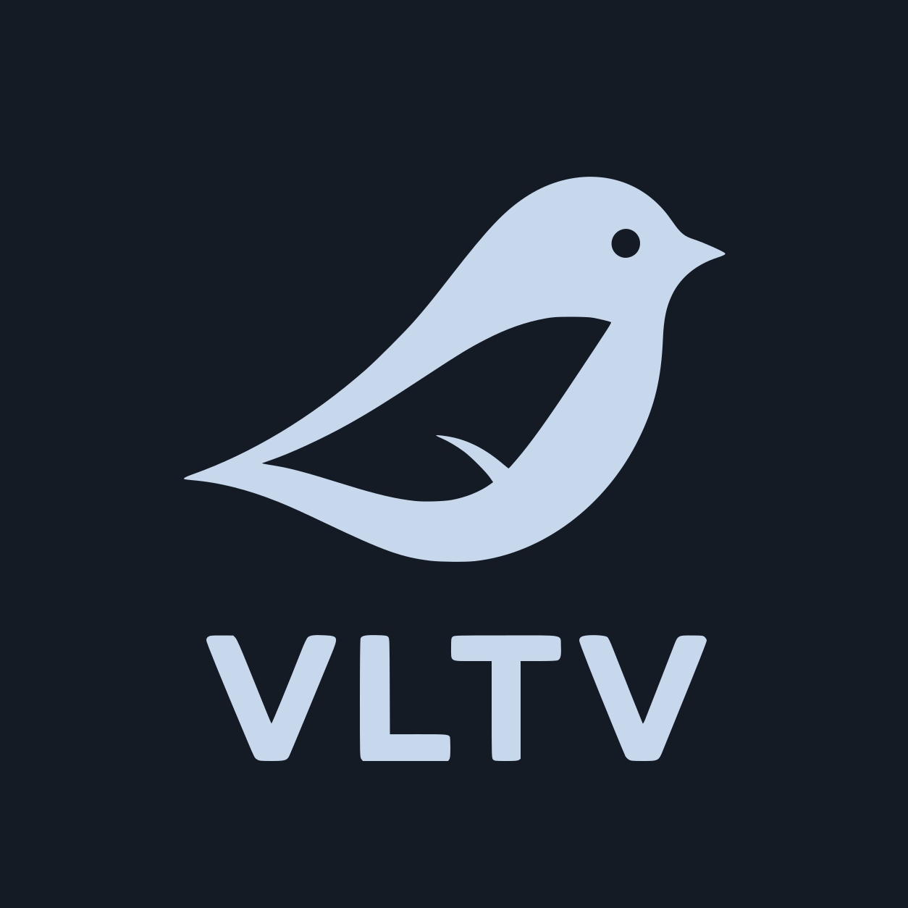

# VireoLumaTV

**VLTV son las iniciales de VireoLumaTV**, utilizadas en el logotipo. El nombre de la aplicación y del proyecto es **VireoLumaTV**.

Un navegador web pensado para tu televisor, desarrollado por **ReinierTutoriales**.

VireoLumaTV te permite navegar en Android TV, Google TV y TV boxes compatibles con el mando o un gamepad. Reúne tus páginas, favoritos y descargas en una interfaz oscura y sencilla.

**[Descargar la última versión](https://github.com/ReinierTutoriales/VireoLumaTV-browser/releases/latest)**

## Qué ofrece

- **Inicio personalizable:** búsqueda, favoritos, accesos directos y acceso a YouTube móvil.
- **Navegación con mando:** controles visibles, foco destacado y pestañas para cambiar entre páginas.
- **Bloqueador integrado:** bloqueo de anuncios y ventanas emergentes, con control por sitio.
- **Búsqueda e historial:** sugerencias de las páginas que ya visitaste.
- **Descargas:** consulta y administra tus archivos desde la aplicación.
- **Modo privado:** una opción de navegación separada de tu sesión habitual.

## Descargar e instalar

Compatible con **Android 7.0 o superior**. En la página de descargas encontrarás estas opciones:

| APK terminado en | Para qué dispositivo |
| --- | --- |
| `arm64-v8a.apk` | Dispositivos con Android de 64 bits |
| `armeabi-v7a.apk` | Dispositivos ARM con Android de 32 bits |
| `x86_64.apk` | Equipos Intel/AMD y emuladores compatibles |

Descarga el APK correspondiente e instálalo en tu dispositivo. Si ya utilizas VireoLumaTV, actualiza sobre la instalación existente para conservar tus datos; no necesitas desinstalarla.

También puedes buscar actualizaciones desde **Ajustes → Acerca de → Actualizar**.

## Más información

[Notas de la versión](RELEASE_NOTES.md) · [Privacidad](PRIVACY.md) · [Licencia](LICENSE.md) · [Avisos de componentes](NOTICE.md)
